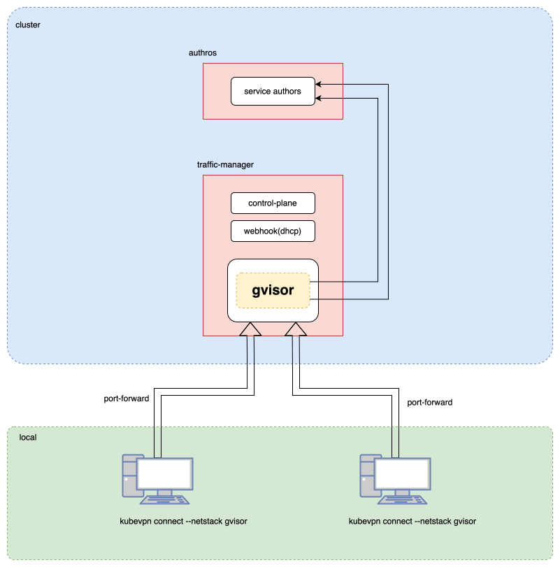

# Connect mode

As shown in the diagram below, both computers can connect to the same cluster network using `kubevpn connect`, enabling
them to access cluster resources locally.

KubeVPN creates a bidirectional network tunnel between the local machine and the Kubernetes cluster. All IP traffic
(TCP, UDP, ICMP) flows through a TUN device on the client, gets encapsulated over TCP, and is forwarded via
`kubectl port-forward` to a traffic manager pod running a userspace network stack (gvisor).

## Architecture

```text
┌────────────────────────────────────────────────────────────────────────┐
│ Local Machine                                                          │
│                                                                        │
│  ┌────────┐    ┌──────────────┐    ┌────────────┐    ┌──────────────┐ │
│  │  App   │───►│  TUN Device  │───►│  Client    │───►│ port-forward │ │
│  │(curl..)│    │ (utun/tun0)  │    │  Engine    │    │ (TCP tunnel) │ │
│  └────────┘    └──────────────┘    └────────────┘    └──────┬───────┘ │
└─────────────────────────────────────────────────────────────┼──────────┘
                                                              │
                                                  kubectl port-forward
                                                              │
┌─────────────────────────────────────────────────────────────┼──────────┐
│ Kubernetes Cluster                                          │          │
│                                                             ▼          │
│  ┌─────────────────────────────────────────────────────────────────┐   │
│  │  Traffic Manager Pod (kubevpn-traffic-manager)                   │   │
│  │                                                                  │   │
│  │  ┌──────────────┐   ┌──────────────┐   ┌──────────────────────┐│   │
│  │  │  TCP Server  │──►│ Gvisor Stack │──►│  TCP/UDP Forwarder   ││   │
│  │  │ (port 10801) │   │ (userspace)  │   │ (dial real service)  ││   │
│  │  └──────────────┘   └──────────────┘   └──────────────────────┘│   │
│  └─────────────────────────────────────────────────────────────────┘   │
└────────────────────────────────────────────────────────────────────────┘
```

## Key Features

- Uses `gVisor` userspace network stack to access k8s `service-cidr` and `pod-cidr` network
- No need for `Privileged: true`
- No need for cap `NET_ADMIN`
- Supports connecting to multiple clusters simultaneously
- Full DNS resolution for Kubernetes service names
- Supports SOCKS5 proxy mode (`--socks`) for nested VPN cases

## Dual Daemon Architecture

KubeVPN uses a dual-process architecture, and the two daemons hold **different session
types** (not one struct with a mode flag):

- **User Daemon** (unprivileged, control plane): Handles SSH jump, traffic-manager
  create/upgrade, file sync, health checks, and connection-state persistence. It does not
  inject sidecars itself — for `proxy`/`leave` it sends the intent to the traffic manager over
  gRPC, which performs the injection server-side (see [Proxy mode](3_proxy.md)). Holds a
  `ConnectOptions` (a.k.a. `ControlSession`).
- **Root Daemon** (root privileges, data plane): Manages TUN device creation, TUN IP
  allocation, routing-table operations, DNS configuration, port forwarding, and the gvisor
  network stack. Holds a `DataSession`.

The two daemons communicate via gRPC over Unix sockets.

### Server-side route & service discovery

The client no longer runs its own cluster-wide pod/service informers. The traffic manager
watches pods and services (scoped to the workload namespace) and pushes the aggregated pod
CIDRs and service records to the client over the gRPC `WatchNamespaceRoutes` stream; the
client feeds them into the route table and DNS. If the manager is too old or lacks the RBAC
for it, the client degrades to CIDR-only routing (the cluster pod/service CIDRs already cover
routing).



## Detailed Architecture


