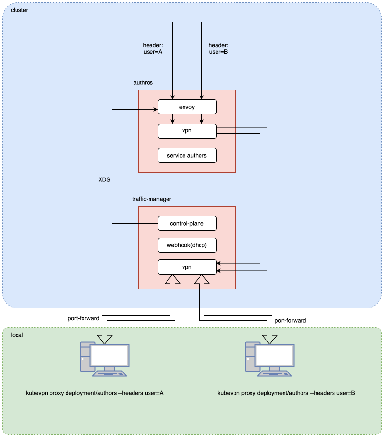

# Proxy with service mesh

As shown in the diagram below, `User A` and `User B` use the `kubevpn proxy` command to proxy the same service `authors`
respectively:

- User A: `kubevpn proxy deployment/authors --headers user=A`
- User B: `kubevpn proxy deployment/authors --headers user=B`

When the `authors` service in the cluster receives traffic:

- Traffic with `user: A` in the `HTTP header` will hit `User A`'s local computer.
- Traffic with `user: B` in the `HTTP header` will hit `User B`'s local computer.
- Unmatched traffic in the `HTTP header` will hit the original `authors` service in the cluster.

The principle is to use `envoy` as the data plane and implement a control plane (xDS) for `envoy`.

Injection runs **server-side**: the client sends the proxy intent to the traffic manager over
gRPC and the manager injects the sidecars with its own ServiceAccount (there is no client-side
injection path). The routing target for each user lives in the Envoy xDS config, so a client
IP change is applied via an xDS push (TCP + UDP) with **no Pod restart**. "VPN-only" proxy
(`kubevpn proxy` without `--headers`) is the same mesh path with empty headers — it matches all
requests on each declared port; there is no separate VPN-only injector.

## Default mode ( need ```Privileged: true``` and cap ```NET_ADMIN``` )

The key is how to implement the function bellow.

> When the `authors` service in the cluster receives traffic

default mode use `iptables` `DNAT` traffic to a **fixed** envoy inbound port `:15006` (not to
any client IP), so works on `Pod` level, best experience. Envoy then routes by header (or the
empty-header catch-all) to the matching user's TUN IP.

example:

```shell
kubevpn proxy deployment/authors --headers user=A
```

