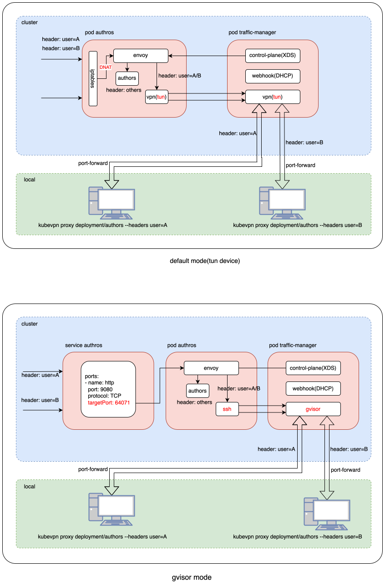

# Proxy with gVisor service mesh

As shown in the diagram below, `User A` and `User B` use the `kubevpn proxy` command to proxy the same service `authors`
respectively:

- User A: `kubevpn proxy deployment/authors --headers user=A`
- User B: `kubevpn proxy deployment/authors --headers user=B`

When the `authors` service in the cluster receives traffic:

- Traffic with `user: A` in the `HTTP header` will hit `User A`'s local computer.
- Traffic with `user: B` in the `HTTP header` will hit `User B`'s local computer.
- Unmatched traffic in the `HTTP header` will hit the original `authors` service in the cluster.

The principle is to use `envoy` as the data plane and implement a control plane for `envoy`.
As with the default mesh mode, injection runs **server-side** in the traffic manager (the
client only sends the intent over gRPC).

## gVisor mode ( not need `Privileged: true` or cap `NET_ADMIN` )

gVisor mode modify `k8s service` `targetPort` to envoy listener port. eg:

```yaml
apiVersion: v1
kind: Service
metadata:
  labels:
    app: authors
    service: authors
  name: authors
  namespace: default
spec:
  clusterIP: 172.21.5.157
  clusterIPs:
    - 172.21.5.157
  ports:
    - name: http
      port: 9080
      protocol: TCP
      targetPort: 64071
  selector:
    app: authors
  sessionAffinity: None
  type: ClusterIP
```

so works on `k8s service` level, needs to access via `service`. if `Pod` registry their `IP` to registration center and
access via `registration center`, this mode will not work.

example:

```shell
kubevpn proxy service/authors --headers user=A
```

We can use this mode on AWS Fargate node,
because [Fargate node](https://docs.aws.amazon.com/AmazonECS/latest/developerguide/fargate-security-considerations.html)
does not support `Privileged: true` and cap `NET_ADMIN`.



## Per-client gvisor stack (data plane internals)

The gvisor data plane was redesigned around three goals: **session continuity** (a dropped tunnel connection must not
kill in-flight gvisor TCP sessions like SSH/SCP), **client isolation** (one slow client must not stall other clients),
and **liveness independence** (data-plane congestion must not starve heartbeat probes and trigger false reconnects).

### Per-client stack (server side)

Each client — identified by its TUN IP — gets an **independent gvisor stack** on the traffic manager, whose lifetime is
the client session rather than any individual connection. Pool-slot tunnel drops only remove a connection from the
routing table; the client's gvisor TCP state (sequence numbers, window, congestion) survives, so when the slot
reconnects the session simply resumes. One slow client can only stall its own stack; other clients are unaffected.

```text
Client A (4 data slots) ─┐
                         ├→ Stack-A (lifetime: client A session) → TCPForwarder → cluster
Client A reconnects ─────┘

Client B (4 data slots) ─┐
                         ├→ Stack-B (lifetime: client B session) → TCPForwarder → cluster
Client B reconnects ─────┘

Inter-client (A→B): direct forwarding via RouteHub (no gvisor stack involved)
```

A stack is created on the first cluster-bound packet from a new client IP and torn down after a grace period (3×
heartbeat cycle ≈ 180 s) once all of that client's data connections are gone — long enough to cover a brief network
glitch or laptop sleep, short enough to reclaim memory from genuinely-disconnected clients.

### Control / data plane separation (client side)

The client opens two kinds of connections to the server:

| Connection | Prefix | Server behavior |
|---|---|---|
| Data slots (×4) | raw IP → inject into gvisor stack | route-registered, carries user traffic |
| Control slot (×1) | control frame (heartbeat ICMP) | not route-registered, never blocked by data congestion |

Heartbeats travel on the dedicated control slot, so even when all four data slots are congestion-blocked the heartbeat
still flows and the liveness watchdog never misjudges the tunnel as dead. Data packets use **blocking** channel sends
instead of silent drops, so backpressure propagates cleanly to OS TCP (smooth window shrink) rather than triggering RTO
exponential backoff stalls.

### Connection pool dispatch

The client multiplexes traffic over a pool of parallel TCP connections. Packets are distributed by a stateless hash of
the flow's five-tuple `(proto, dst IP, src port, dst port)`, so distinct flows to the same hot destination spread across
slots while every packet of one flow stays on one connection (session affinity, no reordering). Packets without usable
ports (ICMP, fragments) fall back to a destination-IP hash. Because the server now keeps one shared gvisor stack per
client, per-flow slot affinity is no longer a correctness requirement but is retained for load distribution.
