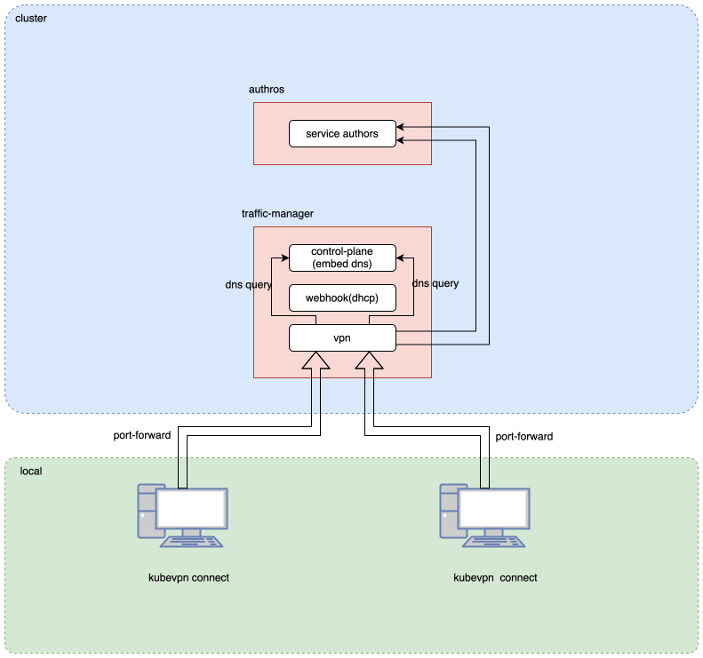

# DNS architecture

As shown in the diagram below, the `kubevpn-traffic-manager` Pod has a built-in `DNS server` for domain name resolution
services.

When accessing resources in the cluster locally using a domain name:

- First, a `DNS query` is sent to the `DNS server`.
- The `DNS server` will try to resolve the given `name`, for example, `authors.default`.
- If the query fails, it will complement the name and retry based on the `search` rules in the `/etc/resolv.conf` file.

## DNS Forward Server

The DNS forward server runs in the traffic manager pod as the `dns` container, listening on port 53.

### Resolution Strategy

For each query (e.g., `my-svc`):

1. **Cache check**: the cache is keyed by `(name, qtype, qclass)` and stores the **full DNS
   response**, not just an FQDN mapping. Positive answers expire at the record's minimum TTL
   (capped at 30 min); `NXDOMAIN`/`NODATA` are negatively cached for the SOA minimum (capped
   at 30 s); transient failures (`SERVFAIL`) are **not** cached.
2. **Single-flight**: concurrent identical misses are coalesced so only one upstream lookup runs.
3. **Search domain expansion**: If not cached, expand the name with all search domains:
   - `my-svc.` (bare name)
   - `my-svc.default.svc.cluster.local.`
   - `my-svc.svc.cluster.local.`
   - `my-svc.cluster.local.`
4. **Fan-out resolution**: For each expanded name × each upstream DNS server, send queries
   concurrently. The first successful response wins and the other in-flight branches are
   cancelled.
5. **Cache update**: Store the winning response for future lookups.
6. **Response rewrite**: Replace expanded name back to original in answer records.

## Client-Side DNS Setup

Platform-specific DNS configuration:

- **Linux**: systemd-resolved (preferred) > tailscale DNS configurator. There is **no
  `/etc/resolv.conf` fallback** — on a host with no split-capable DNS manager, setup logs a
  warning and returns without touching the global resolver (KubeVPN never writes
  `/etc/resolv.conf`).
- **macOS**: /etc/resolver/ directory with per-domain resolver files
- **Windows**: LUID.SetDNS on the TUN interface

Additionally, `/etc/hosts` entries are added for services (service.name -> ClusterIP) to
support short domain resolution. These entries are **push-driven from the traffic manager**:
the manager discovers services and streams them to the client over `WatchNamespaceRoutes`
(see [Connect mode](2_connect.md)), which feeds them to the DNS config — the client no longer
runs its own service informer.

