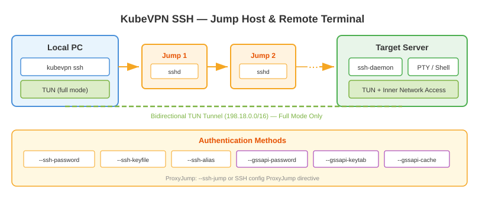

# SSH to remote server

Use command `kubevpn ssh` to connect to a remote server via SSH and optionally create a bidirectional network tunnel.

## Full mode (default)

In full mode, kubevpn not only opens an SSH terminal session, but also installs kubevpn on the remote server (if needed)
and creates a two-way TUN tunnel. This allows you to access the remote server's inner network IPs directly.

```shell
kubevpn ssh --ssh-addr 192.168.1.100:22 --ssh-username root --ssh-keyfile ~/.ssh/ssh.pem
```

## Lite mode

In lite mode, kubevpn only connects to the SSH server without creating the tunnel. This is useful when you just need a
terminal session.

```shell
kubevpn ssh --ssh-addr 192.168.1.100:22 --ssh-username root --ssh-keyfile ~/.ssh/ssh.pem --lite
```

## Multi-hop jump

kubevpn ssh supports ProxyJump for multi-hop SSH chains:

```text
┌──────┐     ┌──────┐     ┌──────┐     ┌──────┐                 ┌────────┐
│  pc  ├────►│ ssh1 ├────►│ ssh2 ├────►│ ssh3 ├─────►... ─────► │ server │
└──────┘     └──────┘     └──────┘     └──────┘                 └────────┘
```

```shell
kubevpn ssh --ssh-alias <alias>
```

## GSSAPI/Kerberos authentication

```shell
kubevpn ssh --ssh-addr <HOST:PORT> --ssh-username <USERNAME> --gssapi-keytab /path/to/keytab
kubevpn ssh --ssh-addr <HOST:PORT> --ssh-username <USERNAME> --gssapi-cache /path/to/cache
kubevpn ssh --ssh-addr <HOST:PORT> --ssh-username <USERNAME> --gssapi-password <PASSWORD>
```


