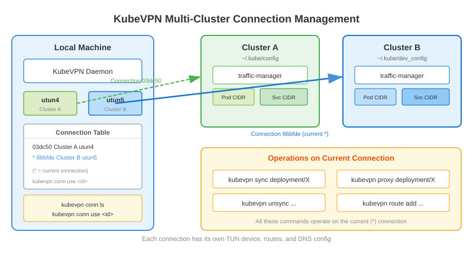

# Connection management

When connecting to multiple Kubernetes clusters simultaneously, kubevpn provides connection management commands to list
and switch between active connections.

## List all connections

```shell
➜  ~ kubevpn connection list
CURRENT   CONNECTION ID   CLUSTER                 KUBECONFIG                      NAMESPACE   STATUS      NETIF
          03dc50feb8c3    ccijorbccotmqodvr189g   ~/.kube/config                  default     connected   utun4
*         86bfdef0ed05    ccidd77aam2dtnc3qnddg   ~/.kube/dev_config              default     connected   utun5
```

You can also use the short aliases:

```shell
kubevpn connection ls
kubevpn conn ls
```

## Switch active connection

Use `connection use` to change the current active connection. Commands like `sync`/`unsync` will operate on the current
connection.

```shell
kubevpn connection use 03dc50feb8c3
```

## Disconnect a specific connection

```shell
kubevpn disconnect 03dc50feb8c3
```

## Disconnect all connections

```shell
kubevpn disconnect --all
```


