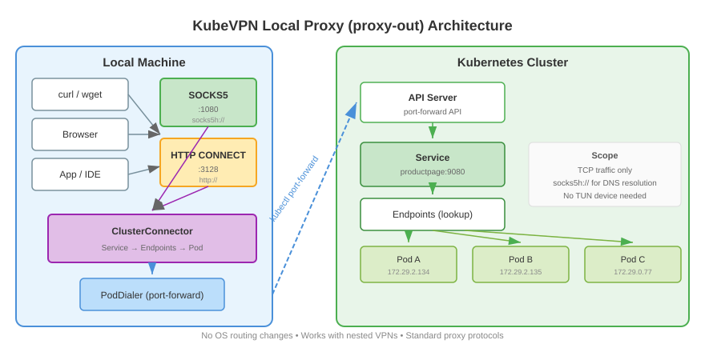

# 本地代理架构

本地代理（`kubevpn proxy-out`）提供 SOCKS5 和 HTTP CONNECT 代理服务器，将流量转发到 Kubernetes 集群。
这使得不支持 VPN/TUN 接口的应用程序（或在无法创建 TUN 的环境中）可以通过标准代理协议访问集群服务。

## 架构

```text
本地应用程序
  │
  ├── SOCKS5 代理 ───────────┐
  │   (socks5://localhost:X)  │
  │                           ▼
  └── HTTP CONNECT 代理 ──► ClusterConnector
      (http://localhost:Y)       │
                                 ├── 解析服务名
                                 │   (Service → Endpoints → Pod)
                                 │
                                 ├── 选择目标 Pod
                                 │   (从就绪端点中随机选择)
                                 │
                                 └── kubectl port-forward
                                     (PodDialer → net.Conn)
```

## 使用场景

- **嵌套 VPN**：当另一个 VPN 客户端占用 OS 路由且无法使用 TUN 时
- **路由冲突**：当集群 CIDR 与本地网络重叠时
- **容器环境**：无法创建 TUN 设备的环境

## 工作原理

本地代理有两种连接器模式，由 `--egress` 选择：

**集群模式（默认，不加 `--egress`）**

1. 启动本地 SOCKS5 和/或 HTTP CONNECT 监听器
2. 当连接到达时，将目标主机名解析为 Kubernetes 服务
3. 查找服务端点找到就绪的 Pod
4. 使用 `kubectl port-forward` 建立到目标 Pod 的 TCP 连接
5. 在客户端和 Pod 之间双向转发流量

**主机出口模式（`--egress`）**

1. 启动本地 SOCKS5 和/或 HTTP CONNECT 监听器
2. 当连接到达时，直接从主机拨号目标
3. 使用主机自身的 DNS 和网络（socks5h 主机出口）——不经过 Kubernetes API 解析
4. 双向转发流量

主机出口模式可直接访问公网。在已有 VPN 连接下也能访问集群，因为主机路由表已经将集群 CIDR 指向了 VPN 隧道。

## 用户守护进程托管的代理

除了独立的 `kubevpn proxy-out` 命令外，同样的代理也可由 `kubevpn connect --socks` 自动启动。在这种形式下，
**用户守护进程**管理代理的生命周期：在连接期间持续运行，断开连接时销毁。使用
`kubevpn connect --socks --egress` 时，托管代理以主机出口模式运行。

## 协议

- **SOCKS5**（RFC 1928）：支持 CONNECT 命令，IPv4/FQDN/IPv6 地址。使用 `socks5h://` 可以让代理端解析集群 DNS 名称。
- **HTTP CONNECT**（RFC 7231）：标准 HTTP CONNECT 隧道，用于 TCP 流量。

范围：仅支持 TCP 流量。UDP 不通过代理支持。


