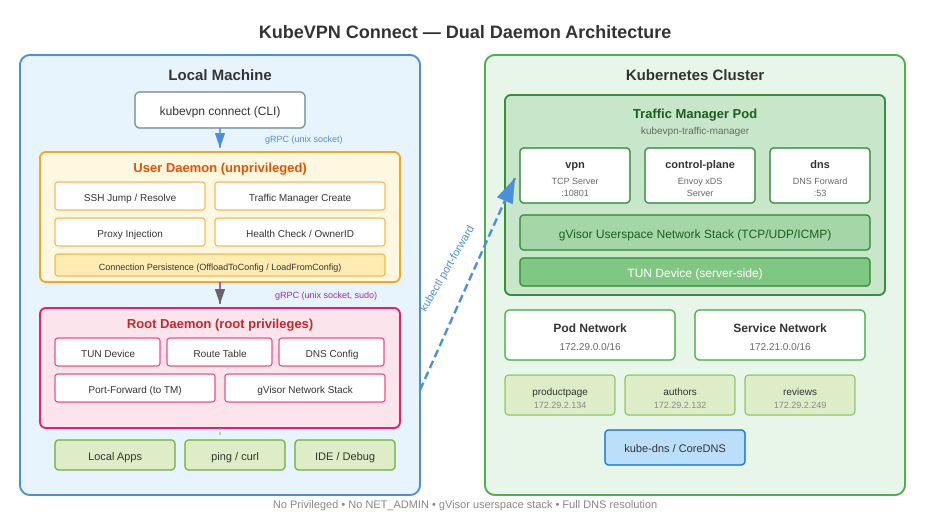

# 连接模式

如下图所示，两台电脑都可以使用 `kubevpn connect` 连接到同一个集群网络，从而在本地访问集群资源。

KubeVPN 在本地和 Kubernetes 集群之间创建一个双向网络隧道。所有 IP 流量（TCP、UDP、ICMP）通过客户端的 TUN 设备，
经过 TCP 封装，通过 `kubectl port-forward` 转发到运行 gVisor 用户态网络栈的流量管理器 Pod。

## 架构

```text
┌────────────────────────────────────────────────────────────────────────┐
│ 本地机器                                                                │
│                                                                        │
│  ┌────────┐    ┌──────────────┐    ┌────────────┐    ┌──────────────┐ │
│  │  应用   │───►│  TUN 设备    │───►│   客户端    │───►│ port-forward │ │
│  │(curl..)│    │ (utun/tun0)  │    │   引擎     │    │ (TCP 隧道)   │ │
│  └────────┘    └──────────────┘    └────────────┘    └──────┬───────┘ │
└─────────────────────────────────────────────────────────────┼──────────┘
                                                              │
                                                  kubectl port-forward
                                                              │
┌─────────────────────────────────────────────────────────────┼──────────┐
│ Kubernetes 集群                                              │          │
│                                                             ▼          │
│  ┌─────────────────────────────────────────────────────────────────┐   │
│  │  流量管理器 Pod (kubevpn-traffic-manager)                        │   │
│  │                                                                  │   │
│  │  ┌──────────────┐   ┌──────────────┐   ┌──────────────────────┐│   │
│  │  │  TCP 服务器   │──►│ gVisor 栈    │──►│  TCP/UDP 转发器      ││   │
│  │  │ (端口 10801) │   │ (用户态)     │   │ (拨号真实服务)       ││   │
│  │  └──────────────┘   └──────────────┘   └──────────────────────┘│   │
│  └─────────────────────────────────────────────────────────────────┘   │
└────────────────────────────────────────────────────────────────────────┘
```

## 关键特性

- 使用 `gVisor` 用户态网络栈访问 k8s `service-cidr` 和 `pod-cidr` 网络
- 无需 `Privileged: true`
- 无需 cap `NET_ADMIN`
- 支持同时连接多个集群
- 完整的 Kubernetes 服务名 DNS 解析
- 支持 SOCKS5 代理模式（`--socks`），适用于嵌套 VPN 场景

## 双守护进程架构

KubeVPN 使用双进程架构，两个守护进程持有**不同的会话类型**（而非同一结构体用标志位区分）：

- **用户守护进程**（非特权，控制面）：处理 SSH 跳转、流量管理器创建/升级、文件同步、健康检查和连接状态持久化。
  它本身不注入 sidecar——`proxy`/`leave` 时通过 gRPC 把意图下发给流量管理器，由其在服务端完成注入
  （见[代理模式](3_proxy.md)）。持有 `ConnectOptions`（即 `ControlSession`）。
- **Root 守护进程**（root 权限，数据面）：管理 TUN 设备创建、TUN IP 分配、路由表操作、DNS 配置、端口转发
  和 gVisor 网络栈。持有 `DataSession`。

两个守护进程通过 Unix 套接字上的 gRPC 通信。

### 服务端路由与服务发现

客户端不再运行自己的集群级 pod/service informer。流量管理器（按工作负载命名空间）watch pod 与 service，
经 gRPC `WatchNamespaceRoutes` 流把聚合后的 pod CIDR 与服务记录推送给客户端；客户端据此更新路由表与 DNS。
若管理器过旧或缺少相应 RBAC，客户端降级为仅按 CIDR 路由（集群 pod/service CIDR 已覆盖路由）。


## 详细架构


