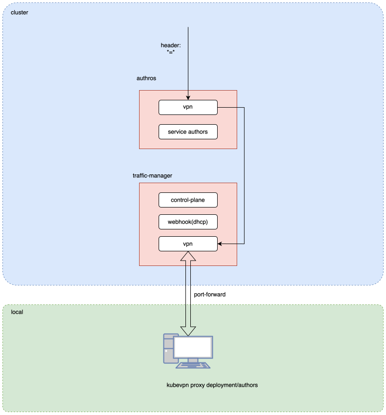

# 代理模式

如下图所示，用户使用命令 `kubevpn proxy deployment/authors` 将工作负载的入站流量拦截到本地电脑。因此无论何人访问集群中的
`authors` 服务，入站流量（工作负载已声明容器端口上的流量）都会被路由到本地电脑上。

代理资源后，还会自动连接到集群网络。只需在本地启动应用程序并等待入站流量即可。

## 工作原理

1. 连接到集群网络（与 connect 模式相同）。
2. **注入在服务端执行。** 客户端通过 gRPC（`ProxyInject`）把代理意图下发给流量管理器；管理器用自己的
   集群内 ServiceAccount 向目标工作负载注入 **VPN + Envoy** 一对 sidecar。没有客户端注入回退路径。
3. 注入的 sidecar 用 iptables DNAT 把入站流量捕获到**固定的** Envoy 入站端口（`:15006`）——不指向任何客户端 IP。
   随后 Envoy 经 xDS 控制面路由：
   - **不带 `--headers`** —— 每个**已声明**容器端口上的所有请求经隧道转发到本地（未声明端口回落到真实应用）；
   - **带 `--headers k=v`** —— 只有匹配的请求到本地，其余打到真实应用（多用户可用不同 header 代理同一工作负载）。
4. 由于路由目标存放在 Envoy xDS 配置里，客户端 TUN IP 变化会被自动感知（TCP + UDP），**无需重启 Pod**。
5. 支持端口映射（`--portmap`）把额外/重命名的端口路由到本地。

"VPN-only" 代理（不带 `--headers`）就是这条 mesh 路径的空 header 形式——没有独立的 VPN-only injector。

```text
┌──────────┐    ┌─────────┌──────────┐    ┌──────────┐
│ ServiceA ├───►│ sidecar │ ServiceB │ ┌─►│ ServiceC │
└──────────┘    └────┌────┘──────────┘ │  └──────────┘
                     │                 │
                     │                 │                     cloud
 ─ ─ ─ ─ ─ ─ ─ ─ ─ ─ ┘─ ─ ─ ─ ─ ─ ─ ─ ─┘ ─ ─ ─ ─ ─ ─ ─ ─ ─ ─ ─ ─ ─
                     │                 │                     local
                 ┌───┘──────┐          │
                 │ ServiceB'├──────────┘
                 └──────────┘
```


