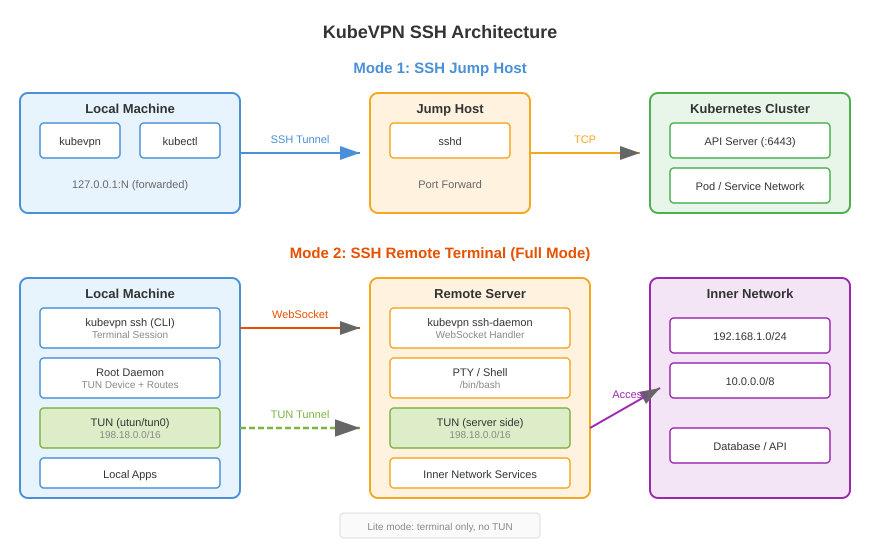

# SSH 架构

KubeVPN 的 SSH 子系统提供两大核心能力：

1. **SSH 跳板机** — 通过 SSH 隧道访问私有网络中的 Kubernetes 集群
2. **SSH 远程终端** — 在远程服务器上创建交互式终端会话，可选建立 TUN 隧道

## SSH 跳板机

当 Kubernetes API Server 在私有网络中不可直达时，通过 SSH 隧道访问：

```text
┌──────┐    SSH 隧道    ┌──────────┐       ┌──────────────┐
│ 本机  ├──────────────►│ 跳板机    ├──────►│ K8s API 服务器│
└──────┘  127.0.0.1:N   └──────────┘       └──────────────┘
```

### 连接流程

1. 建立到跳板机的 SSH 连接
2. 通过 SSH 创建本地端口转发到 API 服务器
3. 重写 kubeconfig 指向本地转发端口
4. 后续所有 kubectl 操作通过 SSH 隧道进行

### 认证方式

| 方式 | 参数 |
|------|------|
| 密码 | `--ssh-password` |
| 密钥文件 | `--ssh-keyfile` |
| SSH 配置别名 | `--ssh-alias` |
| GSSAPI/Kerberos 密码 | `--gssapi-password` |
| GSSAPI keytab | `--gssapi-keytab` |
| GSSAPI 凭据缓存 | `--gssapi-cache` |

### ProxyJump 支持

支持多跳 SSH 链，通过 `--ssh-jump` 或 SSH 配置 `ProxyJump`：

```text
┌──────┐     ┌──────┐     ┌──────┐     ┌──────┐                 ┌────────────┐
│  pc  ├────►│ ssh1 ├────►│ ssh2 ├────►│ ssh3 ├─────►... ─────► │ api-server │
└──────┘     └──────┘     └──────┘     └──────┘                 └────────────┘
```

## SSH 数据面旁路（自动检测）

当您通过 `--ssh-addr` 连接、且该 SSH 主机恰好是一个 Kubernetes 节点时，kubevpn 可以通过 SSH 连接
隧道承载整个 VPN 数据面，而不走 `kubectl port-forward`。这样完全绕过 API server，避开了 port-forward
众所周知的“黑洞”问题（本地 TCP 连接看起来存活，但实际无法传输数据）。因为节点上的 kube-proxy 规则使得
流量管理器的 ClusterIP 可直接到达，SSH 主机可以直接拨号到它。

### 自动检测（无需新增参数）

当提供 `--ssh-addr` 时，root 守护进程会自动探测 SSH 主机能否到达流量管理器的 ClusterIP：

```text
probeSSHDataPlane()
  1. 获取 Service "kubevpn-traffic-manager" → ClusterIP
  2. SSH 拨号 → tcp://<ClusterIP>:10801  （3 秒超时）
  3. 成功 → sshForward()   —— 为所有数据面端口建立 SSH 隧道
     失败 → portForward()  —— 标准 kubectl port-forward（保持不变）
```

无需新增 CLI 参数，也无需新增 proto 字段。仅作堡垒机用途的 SSH 主机（非 K8s 节点）会静默探测失败
并回退到标准 port-forward 路径——完全向后兼容。

### 路径对比

```text
标准路径（port-forward）：
  TUN ─▶ 127.0.0.1:<local> ─▶ [经 API server 的 SPDY/WS] ─▶ pod:10801

SSH 数据面路径：
  TUN ─▶ 127.0.0.1:<local> ─▶ [SSH 隧道] ─▶ node ─▶ ClusterIP:10801 ─▶ pod:10801
```

| 方面 | port-forward | SSH 数据面 |
|---|---|---|
| 依赖 API server | 是（SPDY/WebSocket） | 否 |
| 黑洞风险 | 已知问题 | SSH TCP 可靠 |
| 重连 | 客户端检测 + 重试 | `PortMapUntil` 自动重连 |
| Pod 重启处理 | 需重新查找 Pod | ClusterIP 稳定；kube-proxy 更新端点 |
| 要求 | kubeconfig 访问 | 对 K8s 节点的 SSH 访问 |

存活检测保持不变：心跳看门狗工作在 TUN 层，因此无论底层传输是 port-forward 还是 SSH 隧道，都能正常工作。

## SSH 远程终端

`kubevpn ssh` 命令通过 WebSocket 连接到守护进程，在远程服务器上创建交互式终端。支持两种模式：

- **完整模式**（默认）：连接到 SSH 服务器并创建双向 TUN 隧道，用于内部 IP 通信（使用 198.18.0.0/16 CIDR 范围）
- **精简模式**（`--lite`）：仅连接到 SSH 服务器，不创建隧道

终端会话支持自动窗口大小检测和 raw 终端模式。


