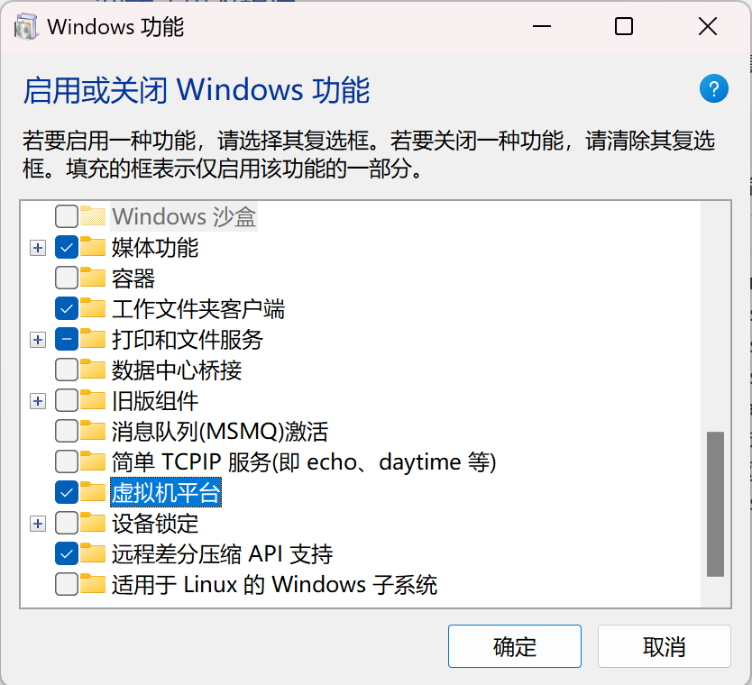

# 在 Windows 11 24H2 上无法使用 kubevpn 提供的任何功能（例如访问 Service IP 或 Pod IP）？

## 解决方案：

启用虚拟机平台 (VMP)，一切都会正常工作！

## 参考：

[Microsoft 文档](https://support.microsoft.com/en-us/windows/enable-virtualization-on-windows-c5578302-6e43-4b4b-a449-8ced115f58e1#:~:text=Step%20three%3A%20Turn%20on%20Virtual%20Machine%20Platform%20in%20Windows&text=Here's%20how%20to%20turn%20it,from%20the%20list%20of%20results)

