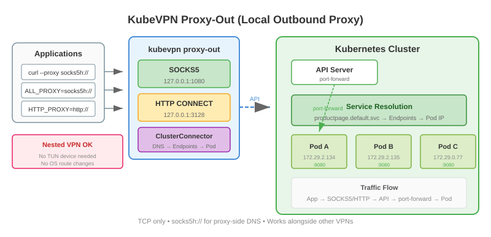

# 本地出站代理 (proxy-out)

对于嵌套 VPN 场景或无法使用 TUN 设备的环境，kubevpn 提供了本地 SOCKS5 和 HTTP CONNECT 代理来访问集群服务。

## 使用场景

当另一个 VPN 客户端已经占用了操作系统路由，无法使用基于 TUN 的连接时，`kubevpn proxy-out` 可以让您通过标准代理协议
访问集群服务。

## 启动 SOCKS5 代理

```shell
kubevpn proxy-out --listen-socks 127.0.0.1:1080
```

然后通过代理访问集群服务：

```shell
curl --proxy socks5h://127.0.0.1:1080 http://productpage.default.svc.cluster.local:9080
```

使用 `socks5h://`（带 `h`）让代理端解析集群 DNS 名称。

## 同时启动 SOCKS5 和 HTTP CONNECT 代理

```shell
kubevpn proxy-out --listen-socks 127.0.0.1:1080 --listen-http-connect 127.0.0.1:3128
```

## 使用环境变量

```shell
export ALL_PROXY=socks5h://127.0.0.1:1080
curl http://productpage.default.svc.cluster.local:9080
```

或使用 HTTP CONNECT 代理：

```shell
export HTTP_PROXY=http://127.0.0.1:3128
export HTTPS_PROXY=http://127.0.0.1:3128
```

## 连接时启动托管 SOCKS 代理

```shell
kubevpn connect --socks
curl --proxy socks5h://127.0.0.1:1080 http://productpage.default.svc.cluster.local:9080
```

托管代理默认监听 `127.0.0.1:1080`，可用 `--socks-listen` 覆盖，例如
`kubevpn connect --socks --socks-listen 127.0.0.1:2080`。托管代理会在断开连接时自动停止。


