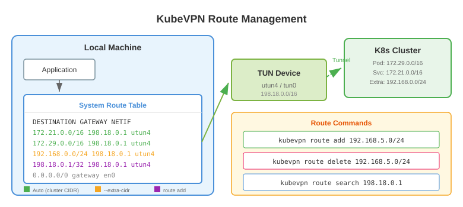

# 路由管理

kubevpn 提供路由管理命令，用于在 TUN 设备上添加、删除和搜索路由。

## 添加路由

向当前连接的 TUN 设备添加自定义路由：

```shell
kubevpn route add 198.18.0.1/32
```

## 删除路由

从 TUN 设备删除路由：

```shell
kubevpn route delete 198.18.0.1/32
```

## 搜索路由

查找特定 IP 的路由信息：

```shell
➜  ~ kubevpn route search 198.18.0.1
DESTINATION  GATEWAY      RT_IFA         MTU    NETIF
198.18.0.1   198.18.0.1   198.18.0.1     1500   utun5
```

## 连接时添加额外路由

也可以在连接时通过参数添加额外路由：

```shell
kubevpn connect --extra-cidr 192.168.0.0/24 --extra-cidr 10.0.0.0/8
kubevpn connect --extra-domain test.example.com
kubevpn connect --extra-node-ip
```


