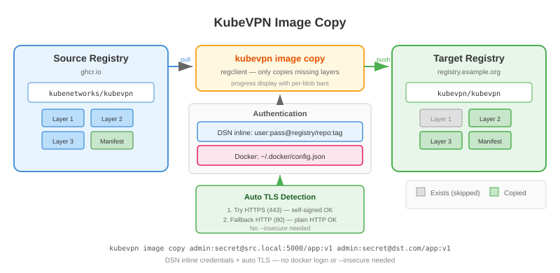

# 镜像管理

kubevpn 提供镜像管理命令，用于跨仓库复制和重新标记容器镜像。基于
[regclient](https://github.com/regclient/regclient) 实现，支持高效的层级传输、DSN 风格内联凭据和自动 TLS 检测。

## 复制镜像

在仓库之间复制镜像。只拉取目标不存在的层，同一仓库中会尝试在仓库间挂载层：

```shell
kubevpn image copy ghcr.io/kubenetworks/kubevpn:latest registry.example.org/kubevpn/kubevpn:latest
```

## 重新标记镜像

在同一仓库中，重新标记只发送带有新标签的 manifest：

```shell
kubevpn image copy ghcr.io/kubenetworks/kubevpn:latest ghcr.io/kubenetworks/kubevpn:v2.3.4
```

## DSN 风格内联凭据

可以直接在镜像引用中嵌入用户名和密码，无需 `docker login`：

```shell
kubevpn image copy admin:secret@registry-a.local:5000/repo:v1 admin:secret@registry-b.example.com/repo:v1
```

格式如下：

```text
[用户[:密码]@]仓库主机[:端口]/命名空间/镜像名[:标签|@摘要]
```

示例：

| 引用 | 解析结果 |
|------|---------|
| `ghcr.io/kubenetworks/kubevpn:latest` | 无凭据，标准引用 |
| `admin:secret@registry.example.com/repo:v1` | 用户 `admin`，密码 `secret` |
| `admin@registry.example.com/repo:v1` | 用户 `admin`，无密码 |
| `user:pass@registry.com/repo@sha256:abcd...` | 凭据 + 摘要引用 |

内联凭据优先于 Docker 凭据存储中同一仓库的凭据。

## 自动 TLS 检测

提供内联凭据时，会自动探测仓库的 TLS 支持：

1. **HTTPS 探测**：尝试 TLS 握手（443 端口）— 成功则使用 HTTPS（自动处理自签名证书）
2. **HTTP 回退**：TLS 失败时，尝试 HTTP GET `/v2/` — 成功则使用 HTTP
3. **默认**：都失败时，默认使用严格 HTTPS

无需手动指定 `http://` 前缀或 `--insecure` 参数。自签名证书的私有仓库和 HTTP 仓库都能开箱即用。

## Docker 依赖说明

**`image copy` 不依赖 Docker。** 机器上没有安装 Docker 也能正常使用。

两条独立的认证路径，按优先级排列：

| 优先级 | 认证方式 | 来源 | 依赖 Docker |
|--------|---------|------|------------|
| 1（高） | DSN 内联凭据 | `user:pass@registry.com/repo:tag` | 不依赖 |
| 2（低） | Docker 凭据存储 | `~/.docker/config.json` | 需要 `docker login` |

没有安装 Docker 时，`WithDockerCreds`/`WithDockerCerts` 静默跳过 — 不报错、不阻断。DSN 内联凭据通过完全独立的路径工作，与 Docker 无任何耦合。

| 场景 | 是否可用 |
|------|---------|
| 无 Docker，有内联凭据 | 可用 |
| 无 Docker，无凭据，公开镜像 | 可用 |
| 无 Docker，无凭据，私有镜像 | 不可用（401） |
| 有 Docker，已 `docker login` | 可用 |
| Docker + 内联凭据（同一 registry） | 可用（内联优先） |

有 Docker 时，自动读取 `~/.docker/config.json`：

```shell
docker login registry.example.org
kubevpn image copy ghcr.io/kubenetworks/kubevpn:latest registry.example.org/kubevpn/kubevpn:latest
```

## 将镜像转存到私有仓库

当集群使用私有仓库时，使用 connect/proxy/run 命令的 `--transfer-image` 选项自动复制 kubevpn 镜像：

```shell
kubevpn connect --transfer-image --image registry.example.org/kubevpn/kubevpn:latest
```

如果私有仓库在 Kubernetes 中需要拉取认证，创建 pull secret 并引用：

```shell
kubevpn connect --image registry.example.org/kubevpn/kubevpn:latest --image-pull-secret-name my-registry-secret
```

`--transfer-image` 与 `--image-pull-secret-name` 是 `connect` / `proxy` / `run` 命令的选项
（用于控制 Kubernetes 如何拉取 kubevpn 镜像），**不是** `kubevpn image copy` 的选项——后者通过
DSN 内联凭证或 Docker 凭证存储进行认证（见上文）。


